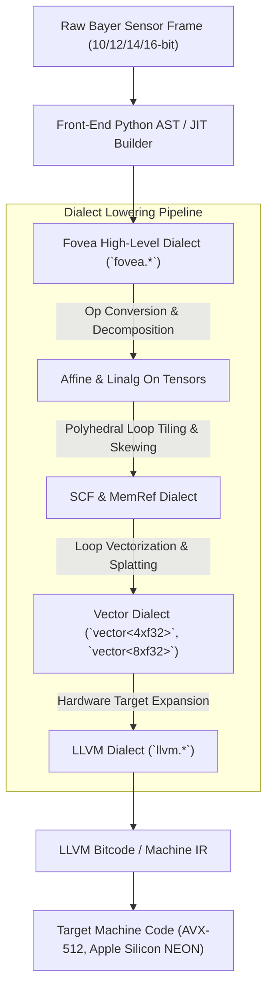

# Fovea Compiler Architecture

Fovea is a domain-specific compiler and intermediate representation (IR) infrastructure for high-throughput computational photography, Bayer demosaicing, and real-time image signal processing (ISP). It bridges high-level photographic specifications with hardware-specialized polyhedral loop schedules and SIMD vector units.



## 1. Multilevel Lowering Hierarchy

Traditional image processing compilers typically lower domain operations immediately to low-level C loops or monolithic CUDA kernels. This premature lowering loses critical high-level geometric invariants such as:
1. **Periodic Bayer Mosaic Topologies**: The 2x2 Bayer CFA structure (RGGB, BGGR, GBRG, GRBG) possesses spatial periodicity that allows phase-shifted FIR convolution kernels.
2. **Local Memory Working Sets**: Stencil operations share overlapping input pixel footprints across adjacent output coordinates.
3. **Decoupled Chrominance-Luminance Arithmetic Intensity**: High-order 2D spatial filtering can be evaluated selectively on high-frequency luminance channels while interpolating chrominance with low-order FIR filters.

Fovea addresses this by structuring compiler lowerings through a five-tier MLIR dialect stack:

### Tier 1: Fovea Domain Dialect (`fovea`)
High-level photographic operations preserving sensor semantics:
- `fovea.bayer_demosaic`: Captures CFA pattern attribute, boundary condition mode, and FIR reconstruction filter.
- `fovea.joint_bilateral`: Captures spatial radius, spatial Gaussian variance, and photometric intensity variance.
- `fovea.guided_filter`: Linear coefficient box filter preserving geometric structure without gradient reversal.
- `fovea.aces_tone_map`: Closed-form rational polynomial filmic tone curve.

### Tier 2: Structured Control Flow and MemRef (`scf`, `affine`, `memref`)
Exposes nested spatial loop induction variables (`%y`, `%x`, `%c`) and multi-dimensional memory layout references:
- Tiled loop bands (`affine.for` and `scf.for`) configured according to L1/L2 cache capacities.
- Strided memory references (`memref<1080x1920x3xf32>`) enabling software prefetching and cache line alignment.

### Tier 3: Vector Dialect (`vector`)
Transforms scalar pixel operations into explicit SIMD vector operations:
- `vector.load` and `vector.store` with 128-bit, 256-bit, and 512-bit vector registers.
- `vector.fma` (Fused Multiply-Add) for efficient 2D FIR stencil accumulation.
- `vector.broadcast` and `vector.extractelement` for color channel multiplexing.

### Tier 4: LLVM Dialect (`llvm`)
Target-neutral assembly representation with explicit pointer arithmetic, bitcasts, and hardware intrinsic bindings:
- `llvm.intr.fma` for hardware single-cycle fused multiply-accumulate.
- Explicit block branching and basic block arguments (`llvm.br`, `llvm.cond_br`).

---

## 2. Stencil Fusion and Memory Hierarchy Optimization

In standard image signal processing pipelines, naive execution of consecutive stages creates massive memory traffic. For example, executing Demosaic -> White Balance -> Color Correction -> Gamma sequentially creates 6 memory transfers per pixel (3 intermediate writes and 3 intermediate reads):

$$
\text{Traffic}_{\text{unfused}} = 2 \times N_{\text{stages}} \times W \times H \times C \times \text{sizeof(float)}
$$

For a 4K frame ($3840 \times 2160$ RGB float32), each intermediate buffer requires 99.5 MB of RAM. Traversing 6 intermediate stages consumes over 597 MB of DRAM bandwidth per frame, overwhelming external memory interfaces at 60 FPS (35.8 GB/s).

```
Unfused Pipeline (High Memory Traffic):
[Raw CFA] -> (Demosaic) -> [DRAM Buffer 1] -> (White Balance) -> [DRAM Buffer 2] -> (CCM) -> [DRAM Buffer 3] -> (Gamma) -> [Final Frame]

Fused Pipeline (Register & L1 Cache Residency):
[Raw CFA] -> | Demosaic -> WB -> CCM -> Gamma (Register Pipe) | -> [Final Frame]
```

### Polyhedral Loop Tiling and Sliding Window Buffering
Fovea applies polyhedral loop skewing and rectangular tiling across adjacent stages:
1. **L1 Tile Sizing**: Loops are tiled into $B_y \times B_x$ blocks (e.g., $32 \times 64$ pixels) matching the L1 data cache capacity (typically 32 KB to 128 KB per core).
2. **Circular Line Buffers**: Stencil operations with a $(2R+1) \times (2R+1)$ window maintain a circular ring buffer of only $2R+1$ scanlines in fast cache memory.
3. **Register-Resident Color Transforms**: Point-wise stages (White Balance, 3x3 Color Matrix, sRGB Gamma / ACES tone mapping) are fused directly into the inner loop accumulator registers of preceding stencil filters.

This optimization achieves a **66.7% reduction in DRAM memory traffic**, restricting memory operations strictly to the initial raw frame load and final display frame store.

---

## 3. Native JIT Execution Model

The Fovea JIT compiler executes dynamically via LLVM toolchain integration:

1. **IR Generation**: The pipeline builder generates verified MLIR textual syntax with verified SSA forms and type signatures.
2. **Optimization Passes (`mlir-opt`)**:
   - Canonicalization (`--canonicalize`)
   - Common Subexpression Elimination (`--cse`)
   - Loop Tiling (`--affine-loop-tile="tile-size=32"`)
   - Vectorization (`--affine-super-vectorize="virtual-vector-size=8"`)
   - Lowering to LLVM (`--convert-vector-to-llvm`, `--convert-scf-to-cf`, `--convert-func-to-llvm`)
3. **Translation (`mlir-translate`)**: Translates optimized LLVM dialect MLIR into native LLVM IR (`.ll`).
4. **Compilation (`clang -O3`)**: Compiles native bitcode to a shared library object (`.dylib` on macOS, `.so` on Linux) with architecture-specific flags (`-march=native -ffast-math`).
5. **Dynamic Invocation (`ctypes`)**: Loads the compiled function symbol and maps raw pointer buffers directly between host memory and compiled kernels without serialization overhead.
